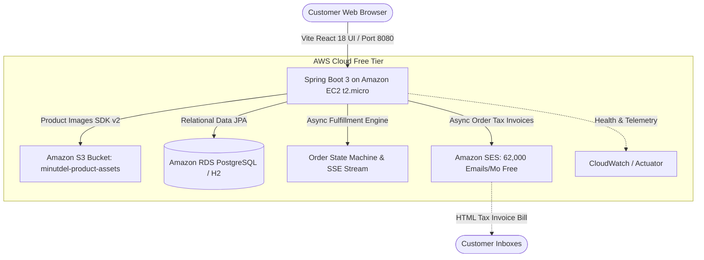

# ⚡ MinutDel — 10-Minute Quick Commerce Cloud Platform

**MinutDel** is an enterprise-grade Quick Commerce platform (modeled after Blinkit / Zepto) built for demonstrating **Cloud Computing Architecture** with **Spring Boot 3, React 18, and AWS Free Tier Services (EC2, S3, RDS, SES, CloudWatch)**.

---

## 🏗️ Architecture Overview



---

## 🌟 Key Cloud & Application Features

1. **Amazon SES Automated Email Billing:**
   - On checkout, customers provide their **Full Name, Email Address, Delivery Address, and Contact Number**.
   - Upon order creation, Spring Boot fires an asynchronous non-blocking event via `AwsEmailService` using **AWS SDK v2 SES Client**.
   - Sends a Blinkit-styled responsive HTML tax invoice containing:
     - Order ID, Dark Store Hub, Date/Time
     - Customer details (Name, Delivery Address, Phone)
     - Itemized table of ordered groceries, quantities, unit prices, subtotal, handling fee, discount, and grand total.
   - Includes fallback simulation mode locally with instant browser preview at `GET /api/orders/{id}/invoice`.
   - **AWS Free Tier compliance:** 62,000 outbound emails/month free when triggered from an EC2 instance.

2. **Mock Payment Gateway & Cash on Delivery (COD):**
   - **Cash on Delivery (COD):** Direct checkout with `PENDING_COD` status; customer pays rider at doorstep.
   - **Mock Online Payment Gateway (UPI / Card / NetBanking):** Razorpay / Stripe style modal with simulated UPI QR code, test card auto-fill, netbanking, and 3-step banking authorization.
   - **Guaranteed Order Confirmation Policy:** Orders are rejected with 400 Bad Request unless either online payment is successfully authorized or Cash on Delivery is selected.
   - Transaction reference IDs (`TXN_MOCK_xxxx` or `COD-DOORSTEP`) are tracked in the database and printed on the AWS SES tax invoice.

3. **10-Minute Real-Time Order Tracking & SSE:**
   - Asynchronous fulfillment engine transitions states:
     - `PLACED` → `PACKING` (picker Rajesh at Dark Store #07) → `RIDER_ASSIGNED` (partner Amit Sharma • +91 98711-22334) → `OUT_FOR_DELIVERY` → `DELIVERED`.
   - Supports real-time Server-Sent Events (SSE) at `/api/orders/{id}/stream` and periodic polling with a simulated GPS Rider Radar map.

3. **AI Meal Assistant (Natural Language):**
   - Natural language meal planner at `POST /api/ai/meal-assist`.
   - Understands dietary choices ("vegan", "breakfast", "high-protein", "party snacks", "keto") and budget limits.
   - Recommends only available database menu items with direct "Add Recommended Items to Cart" buttons.

4. **Admin Analytics Dashboard:**
   - Accessible via Admin login (`admin@minutdel.com` / `admin123`) or modal.
   - Computes live metrics from real JPA queries: Order Volume, Total Revenue, Average Order Value (AOV), Cancellation Rate, and Top Selling Grocery Items.

5. **Role-Based Authentication & Authorization:**
   - Endpoints at `/api/auth/login` and `/api/auth/register` with BCrypt password hashing and role enforcement (`CUSTOMER`, `ADMIN`).
   - Default seeded accounts:
     - **Admin:** `admin@minutdel.com` | `admin123`
     - **Customer:** `customer@minutdel.com` | `customer123`

6. **Cloud Observability Endpoint:**
   - `/api/cloud-info` dynamically reports active host name, cloud environment, database engine, AWS S3 connectivity, and Amazon SES status.

7. **Dual Profile Database Agility:**
   - **Local Development:** Zero-setup in-memory H2 database with Web Console at `/h2-console`.
   - **AWS Cloud Production:** Seamless switch to Amazon RDS PostgreSQL via Spring profile `aws`.

---

## 🚀 Running Locally (Step-by-Step)

### Prerequisites
- **Java 21** & **Maven 3.x**
- **Node.js 18+** & **npm**

### Step 1: Start the Backend (Spring Boot)
Open a terminal:
```bash
cd backend
mvn spring-boot:run
```
* Backend starts at: `http://localhost:8080`
* H2 Database Console: `http://localhost:8080/h2-console` (JDBC URL: `jdbc:h2:mem:minutdeldb`, User: `sa`, Password: *blank*)
* Cloud Info Endpoint: `http://localhost:8080/api/cloud-info`
* Invoice Preview Endpoint: `http://localhost:8080/api/orders/{id}/invoice`

### Step 2: Start the Frontend (React + Vite)
Open a second terminal:
```bash
cd frontend
npm run dev
```
* Frontend starts at: `http://localhost:5173`
* Add items to cart, enter checkout details (Name, Address, Phone, Email), and click **Place Order (Cash on Delivery)**.
* Check the order tracker modal and click **📄 View Bill** to inspect the generated HTML email bill!

---

## ☁️ Deploying to AWS Free Tier (EC2 + S3 + RDS + SES)

### Unified Single-Artifact Deployment
The React frontend is compiled and embedded into Spring Boot's static resources (`backend/src/main/resources/static/`). This means a single `java -jar` command runs both the frontend storefront and backend REST APIs on port 8080 without needing Nginx or Node installed on the server!

### 1. Amazon EC2 Setup
1. Launch an Ubuntu 24.04 `t2.micro` instance (750 hours/month Free Tier).
2. Configure **Security Group** Inbound rules:
   - **Port 22** (SSH): My IP
   - **Port 80** (HTTP): Anywhere (`0.0.0.0/0`)
   - **Port 8080** (Custom TCP): Anywhere (`0.0.0.0/0`)
3. SSH into EC2:
   ```bash
   ssh -i your-key.pem ubuntu@<your-ec2-ip>
   sudo apt update && sudo apt install -y openjdk-21-jdk git maven
   ```
4. Clone and run:
   ```bash
   git clone https://github.com/ArnavAstu/MinutDel.git
   cd MinutDel/backend
   mvn clean package -DskipTests
   java -jar target/minutdel-backend-0.0.1-SNAPSHOT.jar
   ```
5. Open `http://<your-ec2-ip>:8080` in your browser.

### 2. Amazon SES Configuration (Email Billing)
1. Go to AWS Console → **Amazon Simple Email Service (SES)**.
2. In **Identities**, verify your sender email (e.g. `your-verified-email@gmail.com`).
3. If your AWS account is in the **SES Sandbox**, also verify the recipient test email address in SES.
4. Export the environment variables before starting the backend:
   ```bash
   export AWS_REGION=ap-south-1
   export AWS_SES_ENABLED=true
   export AWS_SES_FROM_EMAIL=your-verified-email@gmail.com
   java -jar target/minutdel-backend-0.0.1-SNAPSHOT.jar
   ```
   *(If SES is disabled or credentials are not supplied, MinutDel operates in simulation mode with local invoice rendering.)*

### 3. Amazon RDS (PostgreSQL Database)
1. Create a free-tier PostgreSQL instance (`db.t3.micro` or `db.t4g.micro`).
2. Run backend with the AWS profile:
   ```bash
   java -jar -Dspring.profiles.active=aws \
     -DRDS_JDBC_URL=jdbc:postgresql://<your-rds-endpoint>:5432/minutdeldb \
     -DRDS_USERNAME=<your-username> \
     -DRDS_PASSWORD=<your-password> \
     target/minutdel-backend-0.0.1-SNAPSHOT.jar
   ```

---

## 🎓 Viva / Defense Presentation Cheat Sheet

| Question | Strong Defense Answer |
| :--- | :--- |
| **Why is Quick Commerce relevant to Cloud Computing?** | Quick Commerce relies on sub-second inventory locking, micro-warehouse picking states, and asynchronous fulfillment event lifecycles. Decoupling image media to S3, transactional emails to SES, and database to RDS prevents EC2 server compute starvation during flash demand peaks. |
| **Why did you use Amazon SES for customer billing?** | Storing invoice templates and sending SMTP emails directly from application threads blocks checkout response time and causes IP blacklisting. Amazon SES handles deliverability, DKIM/SPF verification, and provides **62,000 free outbound emails/month from EC2**. |
| **Why did you use S3 instead of storing images on EC2?** | Storing files locally on EC2 makes the server *stateful*, preventing horizontal auto-scaling and wasting expensive EBS block storage. S3 provides decoupled, durable object storage with 99.999999999% durability at zero compute load. |
| **How does this satisfy AWS Free Tier?** | - **EC2 `t2.micro`:** 750 free hours/month<br>- **S3:** 5 GB storage + 20,000 GETs free<br>- **RDS `db.t3.micro`:** 750 free hours/month + 20 GB storage<br>- **SES:** 62,000 free emails/month when sent from an EC2 instance<br>- **CloudWatch:** 5 GB log ingestion free |
| **How did you achieve decoupling and portability?** | Spring Data JPA isolates the persistence layer so switching between local H2 and AWS RDS requires zero code changes. Asynchronous execution (`@Async`) offloads fulfillment state simulation and email dispatch from the main HTTP thread pool. |
