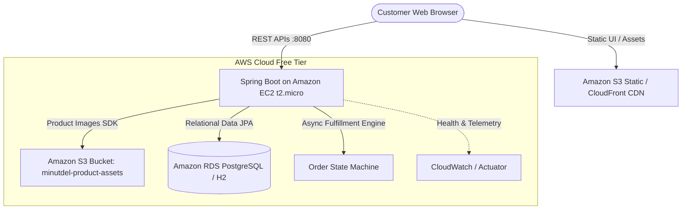

# ⚡ MinutDel — 10-Minute Quick Commerce Cloud Platform

**MinutDel** is a simulated Quick Commerce platform (modeled after Blinkit / Zepto) built for demonstrating **Cloud Computing Architecture** with **Spring Boot 3, React, and AWS Free Tier Services**.

---

## 🏗️ Architecture Overview



---

## 🌟 Key Features

1. **10-Minute Delivery Simulation:**
   - When an order is placed, an asynchronous background engine transitions the state:
     - `PLACED` → `PACKING` (picker collects from Dark Store #07) → `RIDER_ASSIGNED` (partner assigned with phone & name) → `OUT_FOR_DELIVERY` → `DELIVERED`.
2. **Cloud Observability Endpoint:**
   - `/api/cloud-info` dynamically reports active host name, cloud environment, database engine, and AWS S3 bucket status.
3. **Dual Profile Database Support:**
   - **Local Development:** Zero-setup in-memory H2 database with Web Console at `/h2-console`.
   - **AWS Cloud Production:** Seamless switch to Amazon RDS PostgreSQL via Spring profile `aws`.
4. **AWS S3 Image Integration:**
   - AWS SDK v2 service with local fallback when running without cloud credentials.

---

## 🚀 Running Locally (Step-by-Step)

### Prerequisites
- **Java 21** & **Maven 3.x**
- **Node.js 18+** & **npm**

### Step 1: Start the Backend (Spring Boot)
Open a terminal in the root directory:
```bash
cd backend
mvn spring-boot:run
```
* Backend starts at: `http://localhost:8080`
* H2 Database Console: `http://localhost:8080/h2-console` (JDBC URL: `jdbc:h2:mem:minutdeldb`, User: `sa`, Password: *blank*)
* Cloud Info Endpoint: `http://localhost:8080/api/cloud-info`

### Step 2: Start the Frontend (React + Vite)
Open another terminal:
```bash
cd frontend
npm run dev
```
* Frontend starts at: `http://localhost:5173`
* Add items to cart, checkout, and watch the live 10-minute order tracker!

---

## ☁️ Deploying to AWS Free Tier (EC2 + S3 + RDS)

### 1. Amazon S3 (Image Storage)
1. In the AWS Console, create an S3 bucket named `minutdel-product-assets`.
2. Enable public read access for product images or generate IAM credentials with `AmazonS3FullAccess`.

### 2. Amazon EC2 (Hosting Backend + Frontend)
1. Launch an Ubuntu `t2.micro` instance (100% Free Tier).
2. Allow Inbound Traffic on **Port 80**, **Port 8080**, and **Port 22** (SSH) in Security Groups.
3. SSH into EC2:
   ```bash
   ssh -i your-key.pem ubuntu@ec2-xx-xx-xx.compute.amazonaws.com
   sudo apt update && sudo apt install -y openjdk-21-jdk git
   ```
4. Clone this repository and run:
   ```bash
   cd backend
   mvn clean package -DskipTests
   java -jar target/minutdel-backend-0.0.1-SNAPSHOT.jar
   ```

### 3. Amazon RDS (Optional Cloud Database)
1. Create a free-tier **PostgreSQL** instance on RDS (`db.t3.micro` or `db.t4g.micro`).
2. Run backend with the AWS profile:
   ```bash
   java -jar -Dspring.profiles.active=aws \
     -DRDS_JDBC_URL=jdbc:postgresql://<your-rds-endpoint>:5432/minutdeldb \
     -DRDS_USERNAME=<your-username> \
     -DRDS_PASSWORD=<your-password> \
     target/minutdel-backend-0.0.1-SNAPSHOT.jar
   ```

---

## 🎓 Viva / Presentation Defense Cheat Sheet

| Question | Strong Answer |
| :--- | :--- |
| **Why is Quick Commerce relevant to Cloud Computing?** | Quick Commerce relies on low-latency dark-store operations, real-time inventory locking, and asynchronous fulfillment event lifecycles. Decoupling image assets to S3 and database to RDS prevents server bottlenecks. |
| **Why did you use S3 instead of storing images on EC2?** | Storing files locally on EC2 makes the server *stateful*, which breaks auto-scaling. S3 provides decoupled, durable object storage with 99.999999999% durability at zero compute load. |
| **How does this satisfy AWS Free Tier?** | - EC2 `t2.micro`: 750 free hours/month<br>- S3: 5 GB storage free<br>- RDS `db.t3.micro`: 750 free hours/month |
| **How did you achieve decoupling?** | Spring Data JPA isolates the persistence layer so switching between local H2 and AWS RDS requires zero code changes. Order fulfillment runs asynchronously without blocking the checkout HTTP response. |
